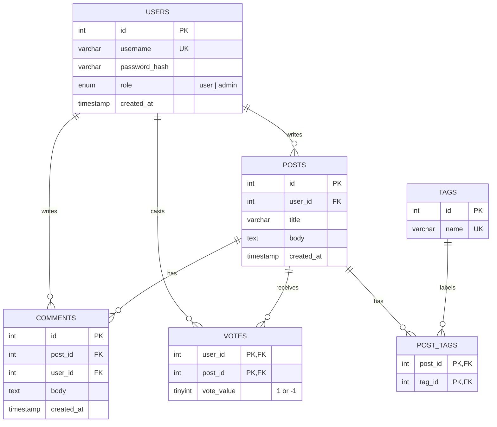

# OpenBoard

A small Reddit-style discussion board built with plain **PHP, MySQL (PDO), HTML and Bootstrap 5**. Users can register, post, vote, comment, tag posts, search, and sort the feed by *Hot*, *New* or *Top*. An admin dashboard lets administrators moderate content.

Built as the final project for the **Web Application Development Lab**. The goal was a complete, understandable application with no frameworks: ordinary PHP pages, HTML forms and straightforward SQL.

> **Live demo:** `https://YOUR-SITE-URL-HERE` *(add after deployment)*
> **Repository:** `https://github.com/YOUR-USERNAME/openboard` *(add after pushing)*

---

## Table of contents

1. [Screenshots](#screenshots)
2. [Features](#features)
3. [Technology stack](#technology-stack)
4. [How it works (architecture)](#how-it-works-architecture)
5. [Database design](#database-design)
6. [Feed ranking: New, Top and Hot](#feed-ranking-new-top-and-hot)
7. [Security measures](#security-measures)
8. [Local installation (Windows + XAMPP)](#local-installation-windows--xampp)
9. [Creating the first admin](#creating-the-first-admin)
10. [Upgrading an existing database](#upgrading-an-existing-database)
11. [Deployment to a web host](#deployment-to-a-web-host)
12. [Project structure](#project-structure)
13. [Manual test checklist](#manual-test-checklist)
14. [Known limitations](#known-limitations)
15. [Future improvements](#future-improvements)

---

## Screenshots

*Add screenshots to `docs/screenshots/` and keep these links, or edit them.*

| Home feed | Post page |
|---|---|
|  |  |

| Create post | Admin dashboard |
|---|---|
|  |  |

---

## Features

**Accounts**
- Registration with a chosen username, or a generated one (`user12345`) if left blank
- Login and logout using PHP sessions
- Passwords stored only as hashes (`password_hash()` / `password_verify()`)
- Public profile page showing a user's posts

**Posts**
- Create, edit and delete your own posts (title, body, up to 5 tags)
- Post pages show the author, timestamp, tags, score and comments
- Copy-link button for sharing a post (with a selectable fallback if the clipboard is unavailable)

**Voting**
- Upvote or downvote any post; change or remove your vote
- One vote per user per post, enforced by the database
- Score = upvotes − downvotes

**Comments**
- Add comments to posts; delete your own comments
- Flat (non-nested) comments with author and timestamp

**Discovery**
- Sort by **Hot**, **New** or **Top**
- Keyword search across post titles and bodies
- Filter by tag (tags are reused, never duplicated)
- Search, tag filter and sort can be combined

**Administration**
- Role-based access (`user` / `admin`) stored in the database
- Admin dashboard with totals for users, posts and comments
- Paged lists of users, posts and comments
- Admins can delete any post or comment
- Admin accounts are created only from the command line or directly in the database, never through a public web page

---

## Technology stack

| Layer | Technology |
|---|---|
| Backend | PHP 8.x (no framework, no Composer packages) |
| Database | MySQL / MariaDB, accessed with PDO and prepared statements |
| Frontend | HTML, Bootstrap 5.3 (via CDN), minimal JavaScript |
| Local environment | XAMPP on Windows (Apache + MySQL + phpMyAdmin) |

JavaScript is used in only two places: the "Copy link" button and `confirm()` prompts before deleting.

---

## How it works (architecture)

OpenBoard is a classic server-rendered application. The browser requests a PHP page. PHP reads or writes MySQL through PDO and sends back finished HTML. No separate API or front-end framework is involved.

```
 Browser                 Apache + PHP                      MySQL
    |  GET /index.php?sort=hot  |                             |
    |-------------------------->|  SELECT ... ORDER BY hot -->|
    |                           |<----------- rows -----------|
    |<-- HTML page (Bootstrap) -|                             |
    |                           |                             |
    |  POST /actions.php (vote) |                             |
    |-------------------------->|  check CSRF + session user  |
    |                           |  INSERT ... ON DUPLICATE -->|
    |<-- 302 redirect to post --|<--------------------------- |
```

**Key design choices**
- **One shared bootstrap file (`db.php`)** loads configuration, opens the PDO connection, starts the session and provides helpers (`e()` for escaping, CSRF functions, `require_login()`, `require_admin()`).
- **Pages fetch first, display second.** Each page runs its PHP logic (and redirects if needed) before including `header.php` and printing HTML.
- **One endpoint for state changes.** `actions.php` handles logout, voting, commenting and deleting. It only accepts POST requests with a valid CSRF token, and it always redirects afterwards (Post/Redirect/Get).
- **Identity comes from the session**, never from form fields. Ownership and role checks are done on the server, in SQL (`WHERE id = :id AND user_id = :me`) or via `require_admin()`.

---

## Database design

Tables: `users`, `posts`, `votes`, `comments`, `tags`, `post_tags`.



**Integrity rules enforced by the database**
- `users.username` is unique, so there are no duplicate accounts.
- `votes` has the composite primary key `(user_id, post_id)`, so a user can have at most one vote per post, even if two requests arrive at once.
- `tags.name` is unique, and `post_tags` has the composite primary key `(post_id, tag_id)`.
- All foreign keys use `ON DELETE CASCADE`. Deleting a post also removes its comments, votes and tag links, so nothing is orphaned.

The full schema is in [`database.sql`](database.sql).

---

## Feed ranking: New, Top and Hot

| Mode | Order |
|---|---|
| **New** | Newest first |
| **Top** | Highest net score first; ties broken by newest |
| **Hot** | Highest *hot value* first (see below); ties broken by newest, then by ID |

**Hot formula**

```
hot = sign(s) × log10(|s| + 1) + t / 45000
```

- `s` is the net score (upvotes − downvotes), the integer shown on each post.
- `t` is the post's creation time in seconds since 1970.
- `45000` seconds is 12.5 hours.

Newer posts rank higher because `t` grows with time. Votes add a bonus (or penalty) measured in 12.5-hour units, and every tenfold increase in `|s| + 1` is worth 12.5 hours:

| Net score | Effect on ranking |
|---|---|
| 0 | none (ranked by age only) |
| +1 | like being ~3.8 hours newer |
| +9 | like being 12.5 hours newer |
| +99 | like being 25 hours newer |
| −9 | like being 12.5 hours older |

The logarithm gives diminishing returns, so a very high score cannot keep an old post on top forever. Because `|s| + 1` is never 0, posts with no votes cause no division-by-zero or log(0) problems. The hot value is only used for ordering. It is never stored or shown.

---

## Security measures

| Threat | Protection |
|---|---|
| SQL injection | PDO prepared statements for all queries that involve user input; sort modes and views are whitelisted |
| Cross-site scripting (XSS) | All user-generated text (titles, bodies, comments, usernames, tags) is escaped with `htmlspecialchars()` through the `e()` helper |
| Cross-site request forgery (CSRF) | Per-session token required on every state-changing form, verified with `hash_equals()` |
| Password theft | Passwords hashed with `password_hash()`; hashes are never displayed |
| Session fixation | `session_regenerate_id(true)` on login, registration and logout; HttpOnly and SameSite cookies |
| Broken authorization | Ownership checked in SQL on edits and deletes; admin role read from the database on every admin request (not stored in the session) |
| Privilege escalation | Registration always creates `user`; the form has no role field; admins are created only via CLI script or direct database access |
| Credential leaks | Database credentials live in `config.php`, which is excluded from Git; connection errors show a generic message and are logged server-side |
| Malformed input | IDs validated with `filter_var`/`filter_input`; arrays and missing values handled safely |

Multi-step writes (a post plus its tags) run in a database transaction.

---

## Local installation (Windows + XAMPP)

### Prerequisites
- [XAMPP](https://www.apachefriends.org/) with PHP 8.x, Apache, MySQL and phpMyAdmin
- Git (optional, for cloning)
- An internet connection (Bootstrap loads from a CDN)

### 1. Get the code
Clone the repository, or download it as a ZIP, into XAMPP's web folder:

```
cd C:\xampp\htdocs
git clone https://github.com/YOUR-USERNAME/openboard.git
```

The project should end up at `C:\xampp\htdocs\openboard` (adjust if XAMPP is installed elsewhere).

### 2. Start XAMPP
Open the XAMPP Control Panel and start **Apache** and **MySQL**. If MySQL won't start because port 3306 is in use, either stop the other MySQL service or move XAMPP's MySQL to port 3307 (change both `port=` lines in `my.ini`, then set the same port in `config.php`).

### 3. Create the database
1. Open `http://localhost/phpmyadmin`.
2. Click the **Import** tab (with no database selected).
3. Choose `database.sql` and click **Import**.

You should now have a database named `openboard` with six tables. (phpMyAdmin may show "No database selected" notices during import; check that the tables exist.)

### 4. Create `config.php`
Copy `config.sample.php` to `config.php` and edit it if needed:

```php
return [
    'host' => 'localhost',
    'port' => 3306,        // 3307 if you moved MySQL
    'name' => 'openboard',
    'user' => 'root',      // XAMPP default
    'pass' => '',          // XAMPP default (empty)
];
```

`config.php` is listed in `.gitignore` and must never be committed.

### 5. Open the site
Go to `http://localhost/openboard/`. You should see the (empty) feed. Register an account, then continue with [Creating the first admin](#creating-the-first-admin).

---

## Creating the first admin

Admins cannot be created from the website. Use one of these methods.

### Method A: command line (recommended locally)

With MySQL running, open Command Prompt:

```
cd C:\xampp\htdocs\openboard
C:\xampp\php\php.exe create_admin.php YOUR_USERNAME
```

- If the username does not exist, you are asked for a password and a new admin account is created.
- If it already exists, that account is promoted to admin and its password is unchanged.
- Running it again is safe: an existing admin is reported as "already an admin" and nothing changes.
- The script refuses to run in a web browser.
- The password is visible while you type on Windows. Clear the terminal afterwards.

### Method B: phpMyAdmin (for hosts without a terminal)

1. On your own computer, generate a password hash (no database needed):
   ```
   C:\xampp\php\php.exe create_admin.php --hash
   ```
   Type a password when asked. The script prints a hash starting with `$2y$`.
2. In the host's phpMyAdmin, open the **SQL** tab and run (replacing the placeholders):
   ```sql
   INSERT INTO users (username, password_hash, role)
   VALUES ('YOUR_USERNAME', 'PASTE_THE_HASH_HERE', 'admin');
   ```
   Or, to promote an account you already registered on the site:
   ```sql
   UPDATE users SET role = 'admin' WHERE username = 'YOUR_USERNAME';
   ```

Never commit passwords or hashes to Git.

---

## Upgrading an existing database

This section is only for databases created by **earlier stages of this project**. For a new installation, just import `database.sql`.

| Your database | What to run |
|---|---|
| Original prototype (only a `posts` table without `user_id`) | Back up, run `migration_001.sql`, import `database.sql` (adds the new tables), then run `migration_002.sql` |
| Has users and posts but no `role` column | Back up, then run `migration_002.sql` only |
| Fresh database | Import `database.sql` only. **Do not** run either migration |

Check whether the `role` column exists with:

```sql
SHOW COLUMNS FROM users LIKE 'role';
```

- Always export a backup from phpMyAdmin (Export → Quick → SQL) before migrating.
- Running `migration_002.sql` twice fails safely ("Duplicate column name 'role'") and changes nothing.
- Old prototype posts are assigned to a placeholder user named `legacy` that nobody can log in as.

---

## Deployment to a web host

OpenBoard runs on any host that provides **PHP 8+**, **MySQL/MariaDB**, **phpMyAdmin** (or equivalent) and a way to upload files (file manager, FTP or SFTP). Host-specific details: **[HOST NAME]** *(fill in after deployment)*.

General procedure:

1. **Create a database and database user** in the host's control panel. Note the exact database **host name**, **database name**, **username** and **password**. These are usually *not* `localhost` / `openboard` / `root`.
2. **Import `database.sql`** into that database using phpMyAdmin. If the host does not let you create a database through SQL, remove the `CREATE DATABASE` and `USE` lines first and select the hosted database before importing. Do not run the migrations on a fresh database, and never import your local development database over production.
3. **Create `config.php` on the server** (not from Git) with the hosting credentials, based on `config.sample.php`.
4. **Upload the application files** (everything except `config.php`'s local copy, `.git/`, and `create_admin.php`) to the site's public web folder (often `htdocs` or `public_html`).
5. **Enable HTTPS** and browse to the HTTPS address.
6. **Create the admin account** with Method B above.
7. **Smoke-test the live site** in a private/incognito window (see the checklist below).

Security checks for production:
- `config.php` must not be downloadable. Opening `https://your-site/config.php` should show a blank page, not source code.
- Do not upload `create_admin.php` unless you need it.
- PHP errors should be logged, not displayed to visitors.

---

## Project structure

```
openboard/
├── .gitignore            excludes config.php
├── README.md
├── config.sample.php     template for local/production settings
├── database.sql          complete schema for a fresh install
├── migration_001.sql     prototype -> accounts upgrade (existing DBs only)
├── migration_002.sql     adds roles (existing DBs only)
│
├── db.php                config, PDO, session, CSRF and auth helpers, shared feed query
├── header.php            HTML head + navbar + flash messages
├── footer.php            closing HTML
├── post_card.php         one post in a list (included by index/profile)
│
├── index.php             feed: search, tag filter, Hot/New/Top
├── post.php              post details, voting, comments, share link
├── create.php            create and edit posts (with tags)
├── register.php          sign up
├── login.php             log in
├── profile.php           user page with their posts
├── actions.php           POST-only: logout, vote, comment, delete (owner and admin)
├── admin.php             admin dashboard
└── create_admin.php      command-line only: create or promote an admin
```

---

## Manual test checklist

The project has no automated tests. This checklist is meant to be run by hand, locally and on the live site. Tick the boxes as you verify each item.

**Accounts**
- [ ] Register with a chosen username; register with a blank username (generated name)
- [ ] Duplicate username (also different capitalization) is rejected
- [ ] Wrong password shows a generic error; correct login works; logout works

**Posts, voting, comments**
- [ ] Create a post with tags; it appears on the feed and post page
- [ ] Edit and delete your own post; no edit/delete controls on other users' posts
- [ ] Upvote, change to downvote, remove vote; the score updates and never double counts
- [ ] Add and delete your own comment; guests see "log in to comment"

**Discovery**
- [ ] Hot, New and Top order posts as expected; order is stable on refresh
- [ ] Search and tag filter work and combine with sorting
- [ ] Empty states appear for no posts and for no search results

**Admin and security**
- [ ] Admin button appears only for admins; `admin.php` is denied to normal users and guests
- [ ] Admin can delete another user's post and comment from the dashboard
- [ ] A normal user cannot perform admin actions by editing a form (expect "Admins only.")
- [ ] A form submitted without its CSRF token is rejected
- [ ] `<script>` in a title, body, comment or username displays as plain text
- [ ] `post.php?id=99999` and `post.php?id=abc` show "doesn't exist", not an error
- [ ] Data persists after logging out and in, and after restarting Apache and MySQL
- [ ] Layout works on a phone-sized screen

---

## Known limitations

- No password reset, email verification or account deletion
- No rate limiting or spam protection (for example CAPTCHA or login throttling)
- The feed shows at most 50 posts and has no pagination (the admin lists are paged)
- Comments are flat (no replies); no image or file uploads
- Admin tools are limited to deleting posts and comments; there is no user management (this also means no web feature can remove or demote the last admin)
- Timestamps use the database server's time zone
- Bootstrap is loaded from a CDN, so the pages need internet access to look correct
- No automated test suite
- Private messaging was out of scope for this version

## Future improvements

- Private messaging between registered users (`messages` table plus inbox pages)
- Pagination or infinite scroll on the feed
- Nested comment threads and comment voting
- Password reset by email and email verification
- Login throttling and CAPTCHA
- Admin user management with a "last admin" safeguard
- Moderation features: reports, post locking, user bans
- Automated tests and a CI workflow

---

## License

*Choose a license (for example MIT) or state "Academic project, all rights reserved".*

## Author

*Your name, course name and institution.*
